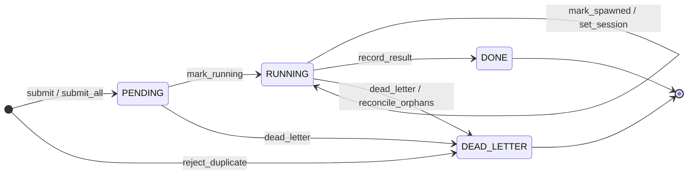

# Dispatcher job state machine

The dispatcher job is the only state machine in the suite. One job is one row
of the `jobs` table in `$ODOO_DEV_HOME/state.db`. The code is
`odoo_dev_data.jobs` (`JobState`, `DeadReason`, `RunOutcome`, `JobStore`, `Job`).
The dispatcher in `libraries/dispatcher` and the apps write the row through
`JobStore`. No caller writes SQL.

## State diagram

## States

| State | Meaning |
|-------|---------|
| `PENDING` | The job is submitted and waits for a free slot. `started_us` is NULL. |
| `RUNNING` | The dispatcher admitted the job. `started_us` is set, `ended_us` is NULL. |
| `DONE` | The session ended and the dispatcher stored a result in `outcome`. |
| `DEAD_LETTER` | The job ended with a named cause in `dead_reason`. |

`PENDING` and `RUNNING` are the live states. `DONE` and `DEAD_LETTER` are the
finished states. A finished job never moves again.

## Transitions

| From | Method | To | Guard |
|------|--------|----|-------|
| (none) | `submit`, `submit_all` | `PENDING` | No other live job for the same `task_id`. |
| (none) | `reject_duplicate` | `DEAD_LETTER` | Records `DUPLICATE_TASK_IN_FLIGHT`. Nothing ran. |
| `PENDING` | `mark_running` | `RUNNING` | Sets `started_us`, `container` and `worktree`. |
| `RUNNING` | `mark_spawned` | `RUNNING` | Moves `started_us` to the session spawn time. |
| `RUNNING` | `set_session` | `RUNNING` | Stores the `session_id`. |
| `RUNNING` | `record_result` | `DONE` | Stores the outcome, branch, PR, token and cost figures and the envelope. |
| `PENDING`, `RUNNING` | `dead_letter` | `DEAD_LETTER` | Stores `dead_reason` and `detail`. |
| `RUNNING` | `reconcile_orphans` | `DEAD_LETTER` | Startup step. Every `RUNNING` row becomes `ORPHANED_BY_RESTART`. |

A method that finds the job in another state raises `InvalidJobTransitionError`.
The SQL `UPDATE` carries the source state in its `WHERE` clause, so two
writers cannot both move a job.

## The duplicate gate

The partial unique index `idx_jobs_one_live` allows at most one `PENDING` or
`RUNNING` job for each `task_id`. `JobStore.submit` inserts the row and turns
the integrity error into `DuplicateTaskInFlightError`. It does not query first.
`submit_all` inserts a whole batch in one transaction. One duplicate rolls back
the batch.

## Dead-letter causes

`DeadReason` has ten values: `DUPLICATE_TASK_IN_FLIGHT`,
`CONTAINER_START_FAILED`, `WORKSPACE_MOUNT_INVALID`, `SESSION_LAUNCH_FAILED`,
`KILLED_BY_DEADLINE`, `KILLED_BY_SIGNAL`, `SESSION_EXIT_NONZERO`,
`STRUCTURED_OUTPUT_MISSING`, `STRUCTURED_OUTPUT_UNREADABLE` and
`ORPHANED_BY_RESTART`. A database `CHECK` ties them to the state: `dead_reason`
is not empty if and only if the state is `DEAD_LETTER`.

## Stored outcomes

`outcome` holds a `RunOutcome` of a `DONE` job: `COMPLETED`,
`COMPLETED_WITH_QUESTIONS`, `BLOCKED` or `FAILED`. `map_reported_outcome` is
the one mapping from the outcome that the agent reports.

| Reported | `question_count` | Stored |
|----------|------------------|--------|
| `done` | 0 | `COMPLETED` |
| `done` | 1 or more | `COMPLETED_WITH_QUESTIONS` |
| `partial` | any | `COMPLETED_WITH_QUESTIONS` |
| `blocked` | any | `BLOCKED` |
| anything else, or none | any | `FAILED` |

## Row columns

| Group | Columns |
|-------|---------|
| Identity | `job_id` (primary key), `batch_id`, `task_id`, `repo`, `round`, `entry`, `brief` |
| Lifecycle | `state`, `submitted_us`, `started_us`, `ended_us`, `submitted_at` (generated), `dead_reason`, `detail` |
| Run | `session_id`, `container`, `worktree`, `outcome`, `branch`, `pr_num`, `tool_version`, `envelope`, `transcript_path` |
| Cost | `input_tokens`, `output_tokens`, `cost_usd` |
| Bundle index | `bundle_dir`, `has_task_json`, `has_session`, `has_envelope`, `bytes`, `harvested_us`, `missing` |
| Orchestrator marks | `approved_us`, `reported_us`, `friction_recorded_us`, `stop_requested_us`, `question_count` |

All times are integer microseconds in UTC. The pair `started_us` and `ended_us`
is the billable window of the job. `Job.billable_window` returns it when both
are set. Table `CHECK` rules enforce the state and time columns together: a
`PENDING` row has no `started_us`, a `RUNNING` row has `started_us` and no
`ended_us`, and a finished row has `ended_us`.

`question_count` counts the questions that the job asked. The `task_question`
command raises it through `JobStore.increment_questions`, and only while the
job is `RUNNING`. `record_result` can set the final value.
`approve_brief`, `request_stop`, `mark_reported` and `mark_friction_recorded`
set the orchestrator marks. Each mark is write-once.

## Artifact bundle

The dispatcher keeps the files of a job in the bundle directory
`$ODOO_DEV_HOME/tasks/<task_id>/jobs/<job_id>/`. `odoo_dev_data.home` builds
the path (`job_bundle_dir`, `ensure_job_bundle_dir`). After the job ends,
`JobStore.index_bundle` stores the path in `bundle_dir`. It also stores
which parts exist (`has_task_json`, `has_session`, `has_envelope`), the size in
`bytes` and the names of missing parts in `missing`. Only a `DONE` or
`DEAD_LETTER` job accepts this call.

## Billing

A finished job with both `started_us` and `ended_us` is a session window.
`odoo_dev_core.sessionization.jobs.derive_windows` folds these windows into the
derived sessions. The session key of such a window is `<task_id>|run:<session_id>`
(see {doc}`event-record-and-payload-policy`).
